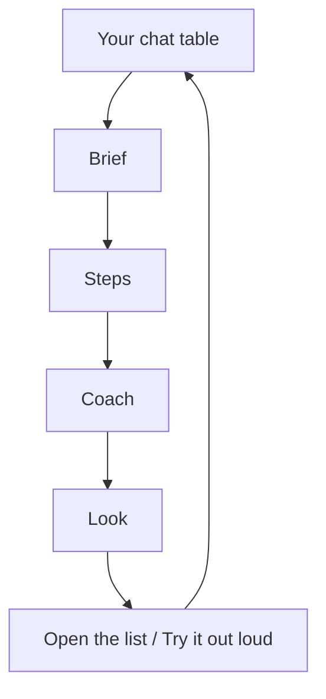

# Day report

> **Label: Reference.** Founder-Approved: Artur, 17 November 2026, document the day. Branch `cursor/chat-builder-phase1-027f`. Not merged. Nothing written to production. The Presentation Builder was read from `origin/cursor/presentation-builder-reference` and was not merged.

## Research

Eight products, plus Lovable and v0, plus the Presentation Builder. Pages and the adopted pieces are in `research.md`. From the deck we took the stepper, the undo chip, the version pill, the orange quote that fills the box, the composer, and the mic (tap to dictate, hold and release to send).

## Flow

Price, model, and paste sit inside Coach, before Look. Detail is in `flow.md`.

## Scores, from the test

`src/components/willab/chats/hostsetup/talkAudit.test.tsx` drives the talk and reads the saved snap.

| Script | Count | Saved result |
| --- | --- | --- |
| Speaking Coach | 14 taps, then 1 Later | spec, recording + message, three walk steps, host checks first, price 0, training on, no model, no paste |
| A shop | 2 mic presses + 18 taps | all four sends, assistant, price 1, training on, model hedge, checked paste |

Both scripts passed (2 / 2). That is the usability and technical evidence for this round. The hand-scored 9.6 and 96% in the previous draft of this page are withdrawn. The screen-by-screen Speaking Coach parity stays in `surfaceParity.test.ts`.

## What changed in the talk

Quotes fill the composer. The stepper, undo chip, version pill, and composer follow the deck. The mic dictates, or holds and sends, and when speech recognition is missing it records and calls the existing transcribe function. Yes and No set the price from the existing 2, 1, 3, 5 list. A model is picked from a quote or typed. A paste is checked and stored only when the check passes.

## Known gaps

The talk's snap is not yet written onto the published coach, so the recording screens still use that document. The audit runs in jsdom with a stand-in recorder, not a phone holding the real mic.
