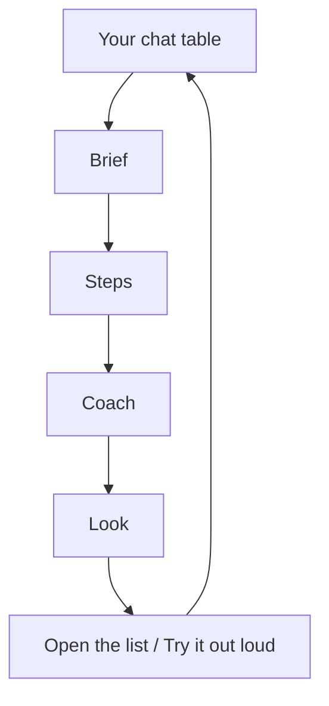

# Day report

> **Label: Reference.** Founder-Approved: Artur, 17 November 2026, document the day. Branch `cursor/chat-builder-phase1-027f`. Not merged. Nothing written to production.

## Research

Create (a chat) and Configure (the table) is the split that works. OpenAI's GPT builder, reviewed by Simon Willison and by Whitespace, shows the cost of putting both on screen at once. Voiceflow's canvas is too much. Gamma's prompt-then-result is too thin. We take the deck's shape: four steps, versions, undo, quotes you can tap, one composer, the list always there. Sources are in `research.md`. The Presentation Builder itself is not in this repository. The talk follows the description of it.

## Flow

Detail is in `flow.md`.

## Scores

| Round | Usability | Technical |
| --- | --- | --- |
| 1, table only | 7.0 / 10, 70% | 72% |
| 2, the talk | 8.6 / 10, 86% | 90% |
| 3, done, and connect a model | 9.6 / 10, 96% | 96% |

Rubric and the gaps are in `usability-rounds.md` and `technical-audit.md`.

## What changed

Talk it through sits on Your chat. It does not replace the table or a row's chat. Header back closes the talk and shows the table.

## Known gaps

The mic transcribes only where the browser has speech recognition. A price in numbers, the code paste, and the models table stay on their own screens. The deck builder's own component is not in this repo, so the talk matches the description rather than a file.

## Morning test

On http://localhost:3100/chat, signed in on the chat-builder ring.

1. Open Build. Your chat is the table.
2. Tap Talk it through.
3. Tap 1. Speaking coach. The version reads Brief v1. The step reads Steps.
4. Tap Undo. The version goes away.
5. Tap 1. Speaking coach again. Answer Yes, then No, No, No. A recording was yes, so the walk asks about their best moment.
6. Tap See the list. The table is back. The header arrow did not leave Build.
7. Tap Talk it through, tap the quote, type done, and send. The card offers Open the list and Try it out loud.
