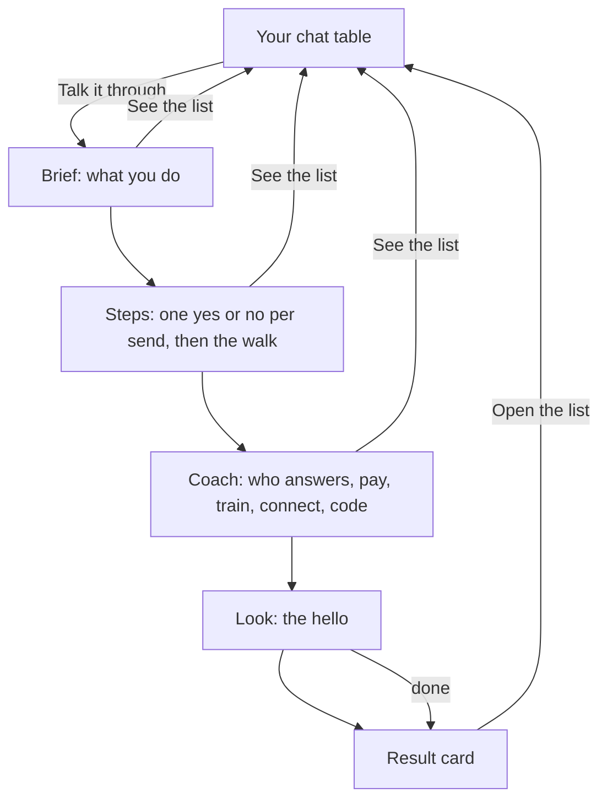

# The talk that builds the chat

> **Label: Reference.** Founder-Approved: Artur, 17 November 2026, design the simplest flow that keeps the depth.

Four names sit under the chats' header: Brief, Steps, Coach, Look. The one that is current is orange.

Each answer that sticks is a version (`Brief v1`, `Steps v2`). Undo restores the previous one.

The composer is one row: mic, a text box that can hold a pasted step, send. A quoted suggestion fills the box and does not send. "You decide" is on the brief and answers only that question. Each later question is its own Yes or No. "Say go?" is the approval after those questions. Only then does the preview open: the first line, Keep, Next, and Publish. Publish marks the draft live on this device and does not call the network. Every answer saves the draft here. Record, Type, Photo, File and Train are chips. "The greeting" and "The price" change only that part. "Write this for me" fills one hard field, then Keep or Rewrite. "Yes", "No", and "the first one" do what the taps do. A tap on the mic dictates. Holding it talks, and letting go sends. When the browser has no speech recognition, the mic records and the recording goes to the existing transcribe route.

The walk steps, once there are two, are a list. Drag one onto another, or tap Earlier / Later.

The home under the header is four equal tiles: 1 Build, 2 Settings, 3 Test, 4 AI. Settings opens the searchable list. A row replaces that bar with its own: the row's name and its place in the list. Header back from the talk returns to the tiles. Your own code, after Yes, is either a description or a paste.
