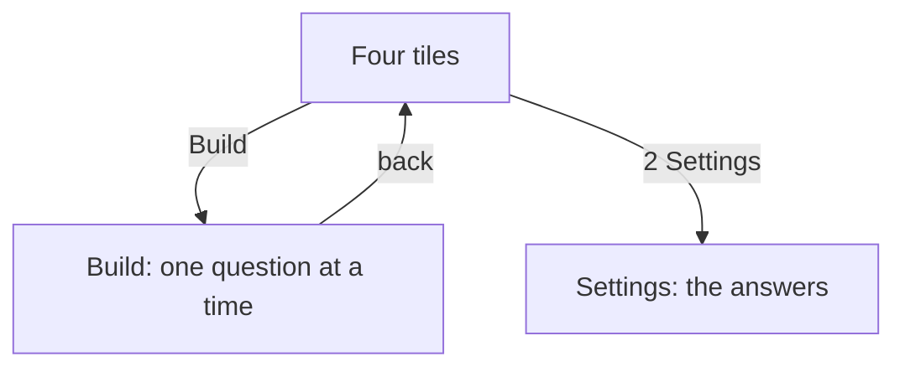

# The talk that builds the chat

> **Label: Reference.** Founder-Approved: Artur, 17 November 2026, design the simplest flow that keeps the depth.

The screen has the app's one top bar and its back arrow. Setup and visitor tests use the [shared composer](../flows/feedback-walk-and-chat.md#shared-composer-n667). Setup fields can be typed. Visitor tests enable the files and mic actions the recipe accepts. Record, stop, and listen to a clip before sending, or discard it and try again.

**Start your own chat** sits at the bottom of the workspace sidebar (N671). It opens a centered confirmation dialog on a computer and a full-width bottom sheet with the Add someone handle on a phone (N668). The backdrop dims the whole viewport. Close, Escape, Back and tapping the backdrop return to the current chat. Confirming opens Chat Builder beside the sidebar and pins the chat by name. **Edit your chat** opens the builder again from the same place.

A structured reply uses the shared chat artifact in Test, the person's own main chat and every named subchat (N673). Its preview opens in the thread, with moment, intervention and output in order when available. A saved turn keeps the artifact's text through reload. A recording jump in the visitor test plays from its original upload while the file is held in the open chat. The website widget uses the same artifact for the host's recorded reply after its normal sign-up step. [Shared chat artifacts](../flows/feedback-walk-and-chat.md#shared-chat-artifacts-n673)

The experiment's help chat uses the same composer throughout. The speaking prompt uses its voice-only state after consent, and the question field is enabled again at the rating step. Its optional case page is selected in Files before the session starts. In the default sample configuration, the recording preview is local and the readout is sample data.

Will asks one question at a time, in a normal chat bubble. The taps sit just above the typing box, and the box is always there. What do you do? offers Speaking coach, ML specialist, Neurobiologist, and Someone else. Someone else focuses the box. Then one question: can people send more than a typed message? Only a Yes asks what they can send: a recording, a photo, or a file. A typed message is always on. Each later question is its own Yes or No. One set of taps at a time. A tap on one of your earlier answers opens that question again. Later answers stay, unless the change makes them wrong. "Say go?" is the approval after those questions. The greeting is then a normal bubble, with Keep above the box. The list of answers is the Settings tile. Publish marks the draft live on this device and does not call the network. Every answer saves the draft here. "The greeting" and "The price" change only that part. "Write this for me" fills one hard field, then Keep or Rewrite.

The walk steps, once there are two, are a list. Drag one onto another, or tap Earlier / Later.

The home under the header is four tiles: Build, Settings, Test, AI. Wide screens show them in one row. A phone stacks them. Settings opens the searchable list. A row replaces that bar with its own: the row's name and its place in the list. Header back from the talk returns to the tiles. Your own code, after Yes, is either a description or a paste.
