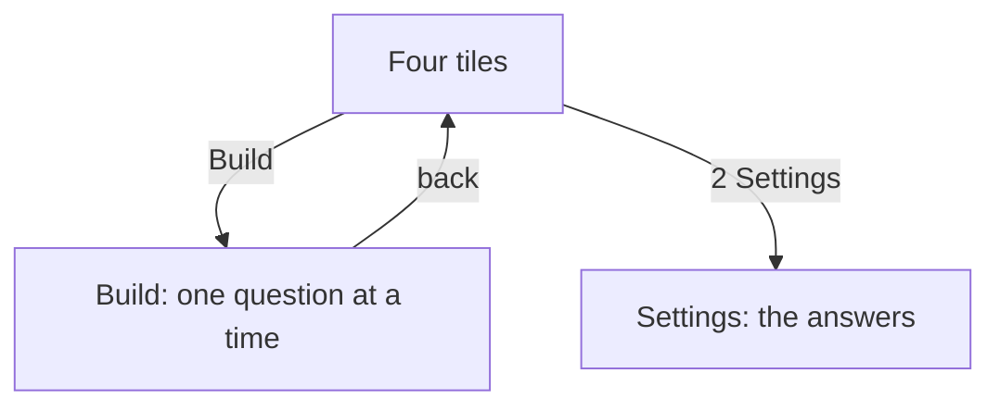

# The talk that builds the chat

> **Label: Reference.** Founder-Approved: Artur, 17 November 2026, design the simplest flow that keeps the depth.

The screen has the app's one top bar and its back arrow. There is no Brief / Steps / Coach / Look bar, no Undo, no mic, and no See the list.

Will asks one question at a time, in a normal chat bubble. The taps sit just above the typing box, and the box is always there. What do you do? offers Speaking coach, ML specialist, Neurobiologist, and Someone else. Someone else focuses the box. Then one question: can people send more than a typed message? Only a Yes asks what they can send: a recording, a photo, or a file. A typed message is always on. Each later question is its own Yes or No. One set of taps at a time. A tap on one of your earlier answers opens that question again. Later answers stay, unless the change makes them wrong. "Say go?" is the approval after those questions. The greeting is then a normal bubble, with Keep above the box. The list of answers is the Settings tile. Publish marks the draft live on this device and does not call the network. Every answer saves the draft here. "The greeting" and "The price" change only that part. "Write this for me" fills one hard field, then Keep or Rewrite.

The walk steps, once there are two, are a list. Drag one onto another, or tap Earlier / Later.

The home under the header is four tiles: Build, Settings, Test, AI. Wide screens show them in one row. A phone stacks them. Settings opens the searchable list. A row replaces that bar with its own: the row's name and its place in the list. Header back from the talk returns to the tiles. Your own code, after Yes, is either a description or a paste.
