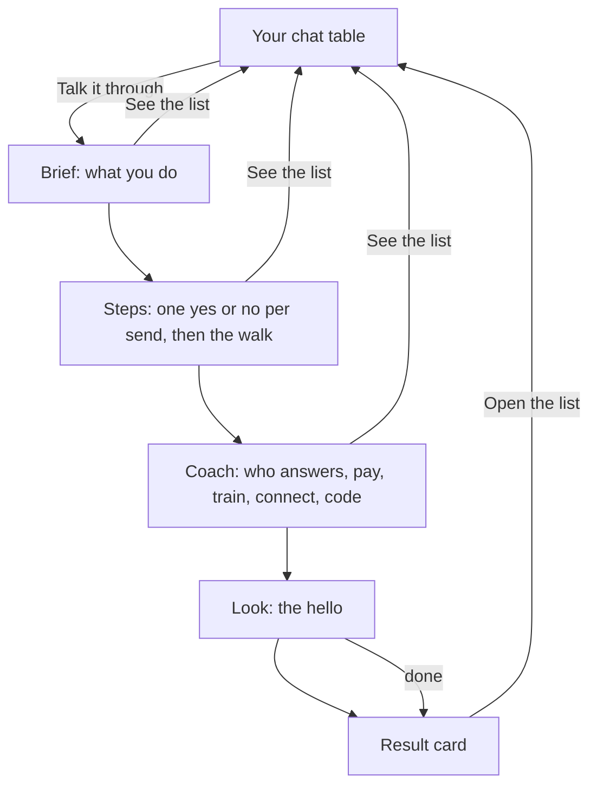

# The talk that builds the chat

> **Label: Reference.** Founder-Approved: Artur, 17 November 2026, design the simplest flow that keeps the depth.

Four names sit under the chats' header: Brief, Steps, Coach, Look. The one that is current is orange.

Each answer that sticks is a version (`Brief v1`, `Steps v2`). Undo restores the previous one.

The composer is one row: mic, text, send. "Yes", "No", "the first one", and "done" do what the taps do. The mic uses the browser's speech recognition when it exists, and otherwise puts the caret in the box.

The walk steps, once there are two, are a list. Drag one onto another, or tap Earlier / Later.

Your chat, the searchable table, is unchanged. Header back from the talk returns to that table. A row chat is unchanged.
